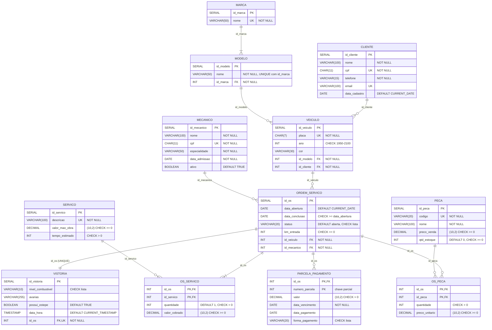

# Modelagem Lógica e Normalização — Oficina Mecânica (Semana 03)

Mapeamento do Modelo Entidade-Relacionamento da Semana 02 para o **modelo relacional**, normalizado até a **3ª Forma Normal (3FN)** e implementado em PostgreSQL.

## Arquivos

| Arquivo | Conteúdo |
|---|---|
| `README.md` | Mapeamento, normalização passo a passo e justificativa da 3FN |
| `diagrama_logico.mermaid` | Diagrama do modelo lógico (tabelas, tipos, PK, FK e restrições) |
| `01_ddl.sql` | `CREATE TABLE` das 12 tabelas com PK, FK, `NOT NULL`, `UNIQUE`, `CHECK` e `DEFAULT` |
| `02_dml.sql` | 3 ou mais `INSERT` por tabela e 4 consultas `SELECT` com `JOIN` |

### Como executar

```bash
createdb oficina
psql -d oficina -f 01_ddl.sql
psql -d oficina -f 02_dml.sql
```

---

## 1. Regras de mapeamento MER → Relacional aplicadas

| Elemento do MER | Regra de mapeamento | Resultado |
|---|---|---|
| Entidade forte | Vira tabela; o identificador vira `PRIMARY KEY` | `cliente`, `veiculo`, `mecanico`, `servico`, `peca`, `ordem_servico`, `vistoria` |
| Entidade fraca | Vira tabela com PK composta: PK da entidade dona + chave parcial | `parcela_pagamento (id_os, numero_parcela)` |
| Relacionamento 1:N | FK no lado N | `veiculo.id_cliente`, `ordem_servico.id_veiculo`, `ordem_servico.id_mecanico` |
| Relacionamento 1:1 | FK em um dos lados com `UNIQUE` | `vistoria.id_os UNIQUE` |
| Relacionamento N:N | Tabela associativa com PK composta pelas duas FKs | `os_servico`, `os_peca` |
| Atributo de relacionamento | Vai para a tabela associativa | `quantidade`, `valor_cobrado`, `preco_unitario` |
| Atributo composto | Decomposto em atributos atômicos | "Fiat Uno 2015 Prata" → marca, modelo, ano, cor |
| Atributo derivado | Não é armazenado; é calculado | `valor_total` da OS |

---

## 2. Normalização passo a passo

### Ponto de partida (não normalizado)

O ponto de partida é a **ficha de ordem de serviço em papel** que a oficina usava, tudo em uma única tabela:

```
FICHA_OS (num_os, data_abertura, status, km_entrada,
          nome_cliente, cpf_cliente, telefone_cliente, email_cliente,
          placa, veiculo,                                  ← "Fiat Uno 2015 Prata"
          nome_mecanico, cpf_mecanico, especialidade,
          combustivel, avarias, estepe,
          { servicos: id_servico, descricao, valor_tabela, tempo, qtd, valor_cobrado },  ← grupo repetitivo
          { pecas: id_peca, codigo, nome_peca, preco_venda, estoque, qtd, preco_unit },   ← grupo repetitivo
          { parcelas: numero, valor, vencimento, data_pgto, forma },                      ← grupo repetitivo
          valor_total)
```

Problemas: não é possível guardar uma quantidade variável de serviços, peças e parcelas em uma linha; o campo `veiculo` mistura quatro informações; e os dados de cliente, veículo e mecânico se repetem em cada ficha.

### 1ª Forma Normal — atributos atômicos e sem grupos repetitivos

**Regra:** todo atributo deve conter um único valor indivisível, e não pode haver grupos repetitivos.

| Problema | Solução |
|---|---|
| `veiculo` = "Fiat Uno 2015 Prata" (atributo composto) | Decomposto em `marca`, `modelo`, `ano`, `cor` |
| Lista de serviços dentro da ficha | Nova tabela, uma linha por serviço da OS, PK `(id_os, id_servico)` |
| Lista de peças dentro da ficha | Nova tabela, uma linha por peça da OS, PK `(id_os, id_peca)` |
| Lista de parcelas dentro da ficha | Nova tabela, uma linha por parcela, PK `(id_os, numero_parcela)` |

Resultado da 1FN:

```
ORDEM_SERVICO (id_os, data_abertura, status, km_entrada,
               nome_cliente, cpf_cliente, telefone_cliente, email_cliente,
               placa, marca, modelo, ano, cor,
               id_mecanico, nome_mecanico, cpf_mecanico, especialidade,
               combustivel, avarias, estepe, valor_total)
OS_SERVICO    (id_os, id_servico, descricao, valor_mao_obra, tempo_estimado, quantidade, valor_cobrado)
OS_PECA       (id_os, id_peca, codigo, nome_peca, preco_venda, qtd_estoque, quantidade, preco_unitario)
PARCELA       (id_os, numero_parcela, valor, data_vencimento, data_pagamento, forma_pagamento)
```

### 2ª Forma Normal — eliminação das dependências parciais

**Regra:** estar na 1FN e todo atributo não chave deve depender da chave primária **inteira**, e não só de parte dela. Só pode haver violação em tabelas com PK composta.

**Dependências parciais encontradas:**

| Tabela | Dependência parcial | Por que é um problema |
|---|---|---|
| `OS_SERVICO` | `id_servico → descricao, valor_mao_obra, tempo_estimado` | A descrição de "Troca de óleo" se repetiria em toda OS que tivesse esse serviço. Renomear o serviço exigiria alterar centenas de linhas (anomalia de atualização), e um serviço nunca executado não poderia ser cadastrado (anomalia de inserção). |
| `OS_PECA` | `id_peca → codigo, nome_peca, preco_venda, qtd_estoque` | O estoque ficaria espalhado em várias linhas, com valores possivelmente diferentes para a mesma peça. Excluir a única OS que usou uma peça apagaria o cadastro da peça (anomalia de exclusão). |

**Solução:** os atributos que dependem só de parte da chave foram movidos para tabelas próprias.

```
SERVICO    (id_servico, descricao, valor_mao_obra, tempo_estimado)
PECA       (id_peca, codigo, nome, preco_venda, qtd_estoque)
OS_SERVICO (id_os, id_servico, quantidade, valor_cobrado)
OS_PECA    (id_os, id_peca, quantidade, preco_unitario)
```

**Atributos que ficaram nas associativas, e por quê:**

- **`quantidade`:** depende da chave inteira, pois é a quantidade *daquela peça naquela OS*.
- **`valor_cobrado` e `preco_unitario`:** também dependem da chave inteira, pois representam o preço praticado *naquela OS, naquela data*. Eles não são cópias de `servico.valor_mao_obra` nem de `peca.preco_venda`, que é o preço atual de tabela e pode mudar amanhã. Sem eles, um reajuste no catálogo alteraria o valor de ordens já pagas.

`PARCELA` já estava na 2FN: valor, vencimento, pagamento e forma dependem de `(id_os, numero_parcela)` juntos. `ORDEM_SERVICO` tem PK simples, então está automaticamente na 2FN.

### 3ª Forma Normal — eliminação das dependências transitivas

**Regra:** estar na 2FN e nenhum atributo não chave pode depender de outro atributo não chave. Ou seja, não pode haver `A → B → C`, em que `A` é a chave.

**Dependências transitivas encontradas:**

| Tabela | Dependência transitiva | Solução |
|---|---|---|
| `ORDEM_SERVICO` | `id_os → cpf_cliente → nome_cliente, telefone_cliente, email_cliente` | Nova tabela `CLIENTE` |
| `ORDEM_SERVICO` | `id_os → placa → marca, modelo, ano, cor, cliente` | Nova tabela `VEICULO`; a OS guarda só `id_veiculo`. O cliente passa a ser obtido via veículo (`veiculo.id_cliente`). |
| `ORDEM_SERVICO` | `id_os → id_mecanico → nome_mecanico, cpf_mecanico, especialidade` | Nova tabela `MECANICO` |
| `VEICULO` | `id_veiculo → modelo → marca` | O modelo determina a marca: todo "Uno" é Fiat. Foram criadas as tabelas `MODELO (id_modelo, nome, id_marca)` e `MARCA (id_marca, nome)`. |
| `ORDEM_SERVICO` | `valor_total` é determinado pelos itens: `id_os → {itens da OS} → valor_total` | Removido. O total passa a ser calculado com `SUM` (consulta Q1 do `02_dml.sql`). |

Sem essas correções, as anomalias seriam:

- **Atualização:** se a cliente trocar de telefone, seria preciso alterar todas as suas OS, e esquecer uma deixaria dados contraditórios.
- **Inserção:** não seria possível cadastrar um cliente, um mecânico ou um modelo de carro antes da primeira OS.
- **Exclusão:** apagar a única OS de um cliente apagaria o próprio cliente.
- **Inconsistência:** alguém poderia digitar "Uno — Volkswagen" em um veículo, ou o `valor_total` armazenado poderia divergir da soma dos itens após uma correção.

> **Sobre o `valor_total`:** tecnicamente é um *atributo derivado*, e não uma dependência transitiva clássica entre colunas da mesma linha. Mas ele gera exatamente o mesmo tipo de redundância e anomalia de atualização, por isso foi tratado nesta etapa.

**E a vistoria?** Seus atributos dependem diretamente de `id_os` (relação 1:1), então manter tudo em `ORDEM_SERVICO` também estaria na 3FN. A tabela separada foi mantida por decisão de modelagem conceitual da Semana 02, e não por exigência da normalização: a vistoria é uma entidade com ciclo de vida próprio (registrada na recepção, antes dos serviços) e pode ganhar novos campos de checklist sem alterar a tabela de OS.

### Resultado final (3FN)

```
CLIENTE           (id_cliente, nome, cpf, telefone, email, data_cadastro)
MARCA             (id_marca, nome)
MODELO            (id_modelo, nome, id_marca → MARCA)
VEICULO           (id_veiculo, placa, ano, cor, id_modelo → MODELO, id_cliente → CLIENTE)
MECANICO          (id_mecanico, nome, cpf, especialidade, data_admissao, ativo)
SERVICO           (id_servico, descricao, valor_mao_obra, tempo_estimado)
PECA              (id_peca, codigo, nome, preco_venda, qtd_estoque)
ORDEM_SERVICO     (id_os, data_abertura, data_conclusao, status, km_entrada,
                   id_veiculo → VEICULO, id_mecanico → MECANICO)
VISTORIA          (id_vistoria, nivel_combustivel, avarias, possui_estepe, data_hora,
                   id_os → ORDEM_SERVICO [UNIQUE])
OS_SERVICO        (id_os → ORDEM_SERVICO, id_servico → SERVICO, quantidade, valor_cobrado)
OS_PECA           (id_os → ORDEM_SERVICO, id_peca → PECA, quantidade, preco_unitario)
PARCELA_PAGAMENTO (id_os → ORDEM_SERVICO, numero_parcela, valor, data_vencimento,
                   data_pagamento, forma_pagamento)
```

Em todas as tabelas, cada atributo não chave depende **da chave, da chave inteira e de nada além da chave**.

### Mudanças em relação ao modelo da Semana 02

| Antes (Semana 02) | Depois (Semana 03) | Motivo |
|---|---|---|
| `veiculo.marca`, `veiculo.modelo` (texto) | Tabelas `marca` e `modelo`; `veiculo.id_modelo` | Dependência transitiva `modelo → marca` |
| `ordem_servico.valor_total` | Removido; calculado nas consultas | Atributo derivado e redundante |
| 10 tabelas | 12 tabelas | — |

---

## 3. Diagrama do Modelo Lógico

O GitHub renderiza o diagrama abaixo automaticamente. Ele mostra os tipos, as PK, as FK, as UK e as restrições de cada coluna; os rótulos das ligações indicam a coluna de FK.



---

## 4. Restrições de integridade (DDL)

| Restrição | Aplicação |
|---|---|
| `PRIMARY KEY` | Todas as tabelas; compostas em `os_servico`, `os_peca` e `parcela_pagamento` |
| `FOREIGN KEY` | 11 FKs; `ON DELETE CASCADE` nas tabelas que só existem dentro de uma OS (vistoria, itens, parcelas) |
| `NOT NULL` | Atributos obrigatórios: nomes, CPF, placa, valores, FKs |
| `UNIQUE` | CPF, e-mail, placa, código da peça, descrição do serviço, nome da marca, `(id_marca, nome)` do modelo, `id_os` da vistoria |
| `CHECK` | Valores e quantidades não negativos, ano entre 1950 e 2100, listas fechadas de status, combustível e forma de pagamento, `data_conclusao >= data_abertura` |
| `DEFAULT` | `CURRENT_DATE` em cadastros e aberturas, status `'aberta'`, estoque 0, quantidade 1, mecânico ativo, estepe `TRUE` |

## 5. Dados e consultas (DML)

O `02_dml.sql` insere de 3 a 5 registros em cada uma das 12 tabelas (47 `INSERT` no total), incluindo inserções que usam os valores `DEFAULT`. As consultas são:

| # | Consulta | Tabelas combinadas |
|---|---|---|
| Q1 | Resumo de cada OS com cliente, veículo, mecânico e total calculado | 8 (6 com `JOIN` + 2 subconsultas agregadas) |
| Q2 | Peças utilizadas em cada OS, com cliente e placa | 5 |
| Q3 | Parcelas em aberto com telefone do cliente e indicação de atraso | 4 |
| Q4 | Faturamento de mão de obra por mecânico (`GROUP BY`) | 3 |

### Resultado da Q1 (validado no PostgreSQL 16)

| id_os | cliente | placa | veiculo | mecanico | status | total_servicos | total_pecas | total_os |
|---|---|---|---|---|---|---|---|---|
| 1 | Ana Souza | ABC1D23 | Fiat Uno | José Pereira | concluida | 80.00 | 215.00 | 295.00 |
| 2 | Bruno Lima | DEF2G34 | Volkswagen Gol | Marcos Alves | concluida | 270.00 | 180.00 | 450.00 |
| 3 | Carla Mendes | GHI3J45 | Chevrolet Onix | Rita Gomes | em_andamento | 100.00 | 520.00 | 620.00 |
| 4 | Ana Souza | JKL4M56 | Fiat Argo | José Pereira | aberta | 80.00 | 0 | 80.00 |

O total vem da soma dos itens, e não de uma coluna armazenada. Por isso nunca pode ficar desatualizado, que é o benefício direto de remover o `valor_total` na 3FN.
